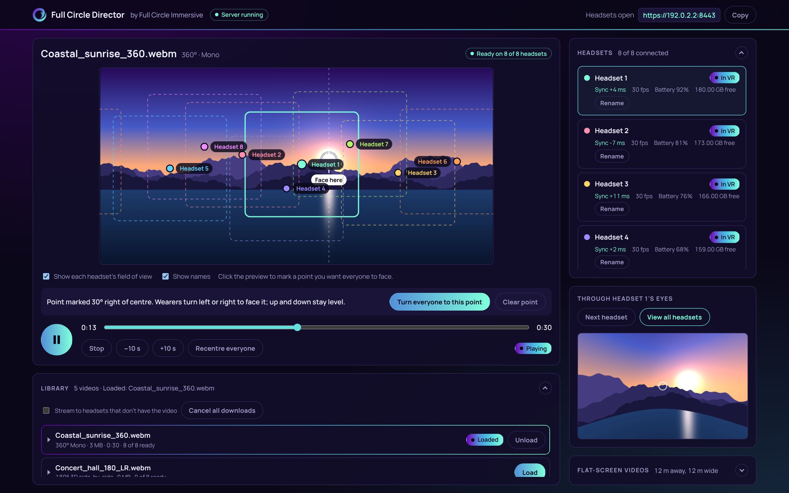
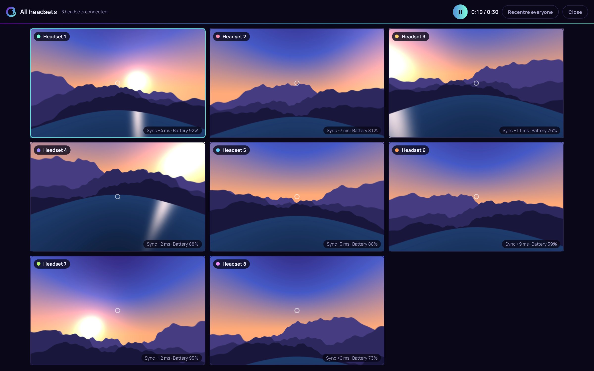

# Full Circle Director

*By Full Circle Immersive.*



*The control panel during a session. Each coloured box is what one headset's wearer can see; the white crosshair marks a point everyone can be turned to face.*



*View all headsets: what every wearer is looking at, side by side.*

Synced 360°, 180° and 3D video playback, and 360° image viewing, across Meta Quest headsets, controlled from one Windows PC on a local network.

- **Server** (`server.js`): serves the headset app over HTTPS with its own certificate, holds the shared playback state, and keeps every headset's clock in step.
- **Control panel** (`public/panel.html`, opens at `http://localhost:8080` on the PC): play, pause, stop and seek for everyone; a live preview showing where each wearer is looking; "through their eyes" views, singly or as a grid; turning everyone to face a chosen point; the media library, with adding files and folders from the panel and stepping through a folder with Previous and Next.
- **Full Circle Player**, the headset app (`public/headset.html`, opens at `https://<PC address>:8443` in the Quest browser): stores videos on the headset, plays them in VR through the headset's compositor layer for smooth 8K, and follows the operator's playback in sync.

## Windows app

`FullCircleDirector-Windows.zip` contains a standalone app: unzip it and run `Full Circle Director.exe`. No Node.js needed. It starts the server itself, shows the control panel in its own window, and keeps media and settings in `Documents\Full Circle Director`.

To build it yourself: `node desktop/build-windows.js` (works on Windows, macOS or Linux; downloads Electron and the Windows build of ffmpeg). The app's code is in `desktop/main.js`.

## Running it from source

1. Install [Node.js](https://nodejs.org) (LTS).
2. Double-click `START.bat`. The first run installs the dependencies (needs internet once).
3. Follow `Setup guide.html` for connecting headsets and running a session.

Settings such as ports and the media folder are in `config.json`.

On slower PCs the control panel previews a light 1080p copy of heavy videos (wider than 4K, or H.265 and similar), made in the background with ffmpeg and kept in `proxies/`. Headsets always play the original. Optional settings in `config.json`:

```json
"proxy": { "enabled": true, "width": 1920, "maxSourceWidth": 3840 },
"ffmpegPath": "C:\\path\\to\\ffmpeg.exe"
```

## Folder layout

| Path | What it is |
| --- | --- |
| `server.js` | The local server |
| `public/` | Control panel, headset app, shared sync code, brand assets |
| `proxies/` | Preview copies for the control panel (made automatically, not stored in the repository) |
| `media/` | Videos and images, loose or in folders (not stored in the repository) |
| `desktop/` | The Windows app (Electron) and its build script |
| `extras/sphere-player.html` | Standalone single-headset test player |
| `Setup guide.html` | Operator setup guide |

Fonts: Manrope, under the SIL Open Font License (`public/fonts/Manrope-OFL.txt`).

## Licence

Free to use, with no subscription or licence fees. Released under the [MIT License](LICENSE): you can use, copy, change and share it, including commercially, as long as the copyright notice is kept.

The parts it is built on have their own open-source licences: three.js, ws and selfsigned (MIT), node-forge (BSD), and the Manrope font (SIL Open Font License, see `public/fonts/Manrope-OFL.txt`).

## Credits

Created by [blockie82](https://github.com/blockie82) for Full Circle Immersive, built with Claude.
